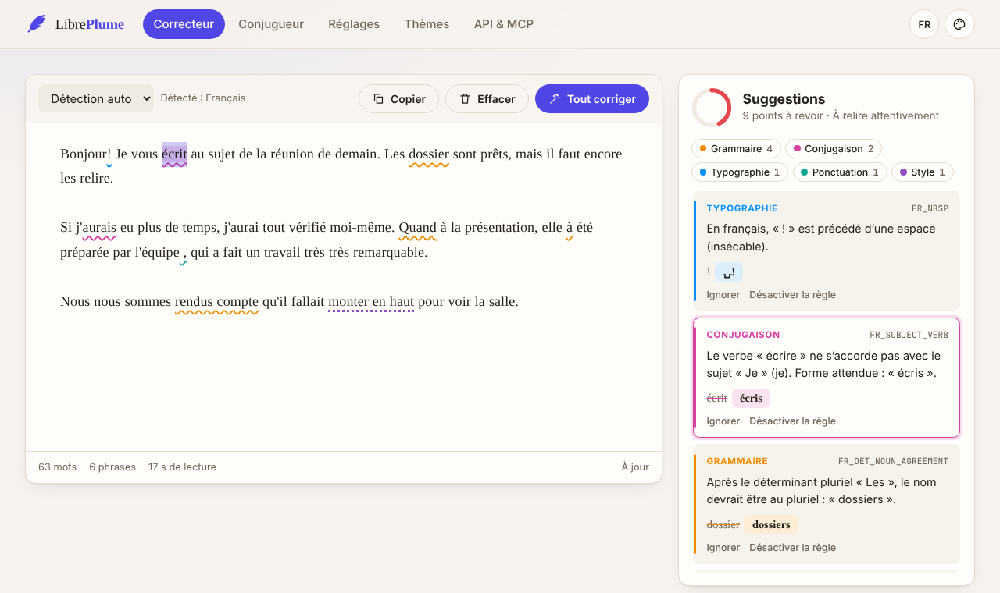
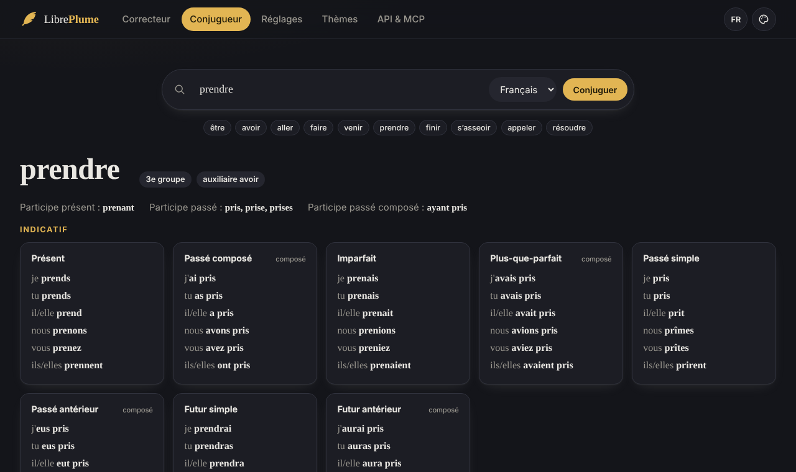
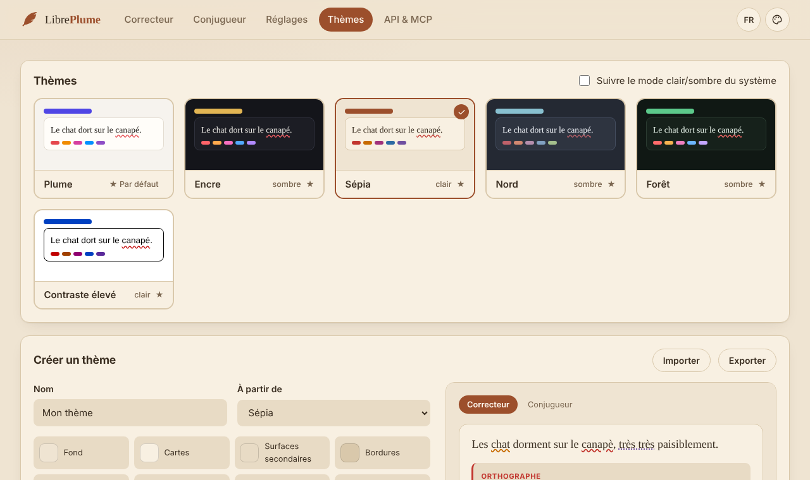
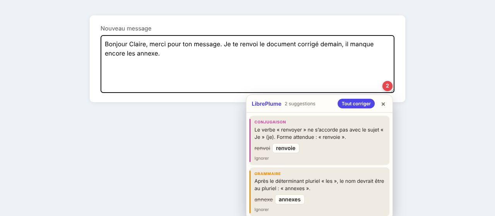

<h1 align="center">🪶 LibrePlume</h1>

<p align="center">
  <strong>A self-hosted grammar, spelling, conjugation, typography and style checker for French and English.</strong><br>
  Rust engine · beautiful web interface with custom themes · MCP server for AI agents · Firefox extension · one small Docker image.
</p>

<p align="center">
  
</p>

## Features

- **Spelling** with the Grammalecte (French) and SCOWL (English) Hunspell dictionaries, a pure-Rust
  spell checker and a shared custom dictionary.
- **Grammar & conjugation**: subject–verb agreement (*tu mange → manges*), infinitive vs past participle
  (*j'ai manger → mangé*, *pour mangé → manger*), *si* + conditional (*si j'aurais → si j'avais*),
  determiner–noun agreement (*les chat → chats*), elision (*le arbre → l'arbre*, *si il → s'il*),
  contractions (*de le → du*), frequent homophones (a/à, et/est, son/sont, on/ont, ce/se, ça/sa,
  c'est/s'est, peu/peut, quand/quant, ou/où, leur/leurs) and fixed expressions (*pallier à*,
  *malgré que*, *se sont rendus compte*…). English: subject–verb agreement, a/an, *could of*, *their is*…
- **Typography & punctuation**: French spacing before `; : ! ?` (with narrow no-break spaces),
  « guillemets », spaces before commas, missing spaces, doubled punctuation, unbalanced brackets,
  capital letters at sentence start, ellipsis and typographic apostrophes (optional).
- **Style**: pleonasms (*monter en haut*), anglicisms (*faire du sens*, *impacter*), familiar
  phrasing (*du coup*), wordiness (*in order to*), weak intensifiers, nearby repetitions, long sentences.
- **Conjugator**: every mood and tense, compound tenses with *être*/*avoir* and agreement, pronominal
  verbs (*s'asseoir*), ~60 irregular models plus the regular groups with their spelling alternations
  (*appeler, acheter, céder, nettoyer, commencer, manger*) — cross-checked against all 8,000 verbs of
  the dictionary. English conjugation too.
- **Web interface**: live checking with coloured underlines, one-click (and undoable) fixes,
  *fix all*, quality score, category filters, statistics, conjugator, rule and dictionary settings,
  six built-in themes and a **theme editor** (colours, fonts, size, radius, import/export).
  French and English UI, responsive, keyboard and screen-reader friendly, no external resources.
- **MCP server** (Streamable HTTP and stdio): AI agents can check, correct and conjugate, and
  manage rules, dictionary, settings and themes.
- **REST API** and a **LanguageTool-compatible endpoint** (`/v2/check`) for existing clients.
- **Firefox extension**: checks what you type on any website through your own server.
- Small and fast: a ~12 MB distroless image, ~60 MB of RAM, dictionaries load in 0.3 s.

<p align="center">
  
  
</p>

## Quick start

### Single binary

LibrePlume is one self-contained executable: dictionaries and the web interface are built in.
Download the archive for your system from the
[latest release](https://github.com/pmorcrette/LibrePlume/releases/latest) (Linux x86-64/ARM64
static binaries, macOS Intel/Apple Silicon, Windows), then:

```sh
tar xzf libreplume-*-x86_64-unknown-linux-musl.tar.gz
cd libreplume-*/ && ./libreplume serve --port 8080 --data-dir ./data
```

Check the download against `SHA256SUMS` from the same release (`sha256sum -c SHA256SUMS --ignore-missing`).

### Docker

```sh
docker compose up -d --build  # builds the image and starts it on http://localhost:8080
```

or without Compose:

```sh
docker build -t libreplume .
docker run -d --name libreplume -p 8080:8080 -v libreplume-data:/data \
  -e LIBREPLUME_TOKEN=change-me libreplume
```

Open <http://localhost:8080>. Settings, the custom dictionary and custom themes are stored in the
`/data` volume.

### Configuration

| Variable | Default | Meaning |
| --- | --- | --- |
| `LIBREPLUME_PORT` | `8080` | Listening port |
| `LIBREPLUME_HOST` | `0.0.0.0` | Listening address |
| `LIBREPLUME_DATA_DIR` | `/data` (image), `./data` | Where settings, dictionary and themes are stored |
| `LIBREPLUME_TOKEN` | *(none)* | Bearer token required for every change (settings, rules, dictionary, themes) and for `/mcp`. **Set it on any shared server.** Checking text stays open. |
| `LIBREPLUME_MAX_TEXT_CHARS` | `200000` | Maximum text length per check |
| `LIBREPLUME_LOG` | `info` | Log filter (`debug`, `libreplume=debug,tower_http=warn`…) |

Put the server behind a reverse proxy (Caddy, Traefik, nginx) for HTTPS when it is reachable from
the internet.

## Connecting AI agents (MCP)

LibrePlume implements the [Model Context Protocol](https://modelcontextprotocol.io).

**HTTP** — Claude Code:

```sh
claude mcp add --transport http libreplume http://localhost:8080/mcp \
  --header "Authorization: Bearer $LIBREPLUME_TOKEN"
```

Other clients (Claude Desktop, Cursor, …):

```json
{
  "mcpServers": {
    "libreplume": {
      "type": "http",
      "url": "http://localhost:8080/mcp",
      "headers": { "Authorization": "Bearer <token>" }
    }
  }
}
```

**stdio** — through the running container (no token needed, it is a local process):

```json
{ "mcpServers": { "libreplume": { "command": "docker", "args": ["exec", "-i", "libreplume", "libreplume", "mcp"] } } }
```

| Tool | What it does |
| --- | --- |
| `check_text` | Lists issues with rule, category, severity, explanation, UTF-16 position and suggestions |
| `correct_text` | Returns the corrected text, the applied changes and what is left for a human |
| `conjugate_verb` | Full conjugation table (optionally filtered by tense) |
| `list_rules`, `set_rule_enabled` | Inspect and toggle rules |
| `get_settings`, `update_settings` | Default language, sentence length, disabled categories, default theme |
| `list_dictionary`, `add_dictionary_words`, `remove_dictionary_words` | Manage the shared dictionary |
| `list_themes`, `save_theme`, `delete_theme` | Manage interface themes |
| `server_info` | Version, languages and endpoints |

Settings, dictionary, rules and themes are also exposed as MCP resources, and two prompts
(`proofread`, `improve_style`) guide an agent through a review.

## REST API

All routes speak JSON; positions are **UTF-16 code units** (directly usable with JavaScript strings).

```sh
curl -s localhost:8080/api/check -H 'Content-Type: application/json' \
  -d '{"text": "Ils mangeons des pomme.", "language": "fr"}'

curl -s localhost:8080/api/correct -H 'Content-Type: application/json' \
  -d '{"text": "He go home."}'                      # → "He goes home."

curl -s localhost:8080/api/conjugate/s%E2%80%99asseoir
```

| Route | Body / query |
| --- | --- |
| `POST /api/check` | `{ text, language?, categories?, disabled_rules?, enabled_rules?, extra_words? }` |
| `POST /api/correct` | `{ text, language?, categories? }` |
| `GET /api/conjugate/{verb}` | `?language=fr\|en` |
| `GET /api/rules` · `PUT /api/rules/{id}` | `?language=&category=` · `{ enabled }` |
| `GET` · `PATCH /api/settings` | `{ default_language, max_sentence_words, disabled_categories, default_theme }` |
| `GET` · `POST` · `DELETE /api/dictionary` | `{ word }` or `{ words: [...] }` |
| `GET /api/themes` · `PUT` · `DELETE /api/themes/{id}` | `{ name, dark, variables }` |
| `GET /api/info`, `GET /api/health` | |
| `POST /v2/check`, `GET /v2/languages` | LanguageTool-compatible (form: `text` or `data`, `language`) |
| `POST /mcp` | MCP (JSON-RPC) |

When `LIBREPLUME_TOKEN` is set, send `Authorization: Bearer <token>` (or `X-API-Key`) with changes.

## Firefox extension

<p align="center"></p>

The add-on in [`extension/firefox`](extension/firefox) checks text areas and rich text editors on any
website, shows a badge with the number of issues and a panel to apply fixes, adds *Check* and
*Conjugate* to the context menu, and offers a popup for pasted text. Texts are sent only to the
server you configure. See its [README](extension/firefox/README.md) to load or package it.

## Themes

Pick a theme in **Thèmes / Themes** (the choice is remembered per browser), or set the server-wide
default for new visitors. The editor creates custom themes shared by everyone on the server; a theme
is a set of CSS variables:

```json
{
  "id": "ocean",
  "name": "Océan",
  "dark": true,
  "variables": {
    "bg": "#0b1622", "surface": "#102030", "surface-2": "#16293d", "border": "#22384f",
    "text": "#e6f1fa", "text-muted": "#8ea6bb", "accent": "#38bdf8", "accent-contrast": "#04121c",
    "spelling": "#f87171", "grammar": "#fbbf24", "conjugation": "#f472b6", "typography": "#60a5fa",
    "punctuation": "#2dd4bf", "style": "#c084fc",
    "font-text": "\"Literata\", Georgia, serif", "text-size": "1.125rem", "radius": "14px"
  }
}
```

Values are validated so that a theme can only set colours, fonts and sizes — never inject CSS.

## Command line

```sh
libreplume serve                 # default command
libreplume mcp                   # MCP over stdio
libreplume check notes.md -l fr  # prints issues, exits 1 if any (handy in CI)
libreplume healthcheck           # used by the Docker health check
```

## Development

```sh
cargo run -p libreplume-server              # http://localhost:8080, data in ./data
cargo test --all                            # unit, rule and API tests
cargo test --release -p libreplume-core --test conjugator_vs_dictionary -- --ignored --nocapture
cargo run -p libreplume-core --example check -- fr < text.txt   # try the rules on each line
```

```
crates/
  libreplume-core/     engine: tokenizer, dictionaries, conjugators, rules
    dictionaries/      Hunspell dictionaries (embedded in the binary)
    src/rules/         spelling, French, English, phrase tables, style
  libreplume-server/   axum server: REST API, MCP, LanguageTool API, storage, themes
web/                   web interface (plain HTML/CSS/ES modules, embedded in the binary)
extension/firefox/     Firefox add-on (Manifest V3)
```

### Releasing

Bump `version` in the root `Cargo.toml`, run `cargo check` to refresh `Cargo.lock`, set the same
version in `extension/firefox/manifest.json` (without any `-rc` suffix), merge to `master`,
then tag that commit:

```sh
scripts/check-release-version.sh v0.2.0   # same check as CI
git tag v0.2.0 && git push origin v0.2.0
```

The *Release* workflow checks that the tag is on `master` and matches the crate version, builds and
smoke-tests the binaries for every platform, packages the Firefox extension and publishes them with
checksums as a GitHub release. The *CI* workflow publishes the matching Docker image to GHCR.

Rules are small functions over a tokenized text (see `crates/libreplume-core/src/rules`); fixed
expressions live in tables in `rules/phrases.rs`, which is the easiest place to contribute.
Every rule is tested on wrong sentences **and** on a corpus of correct prose to avoid false
positives. Commits follow [Conventional Commits](https://www.conventionalcommits.org/).

## License

LibrePlume is free software under the [GNU GPL v3 or later](LICENSE).
The French dictionary is © Olivier R. / Grammalecte (MPL 2.0) and the English dictionary comes from
SCOWL (see `crates/libreplume-core/dictionaries/*/LICENSE`).
